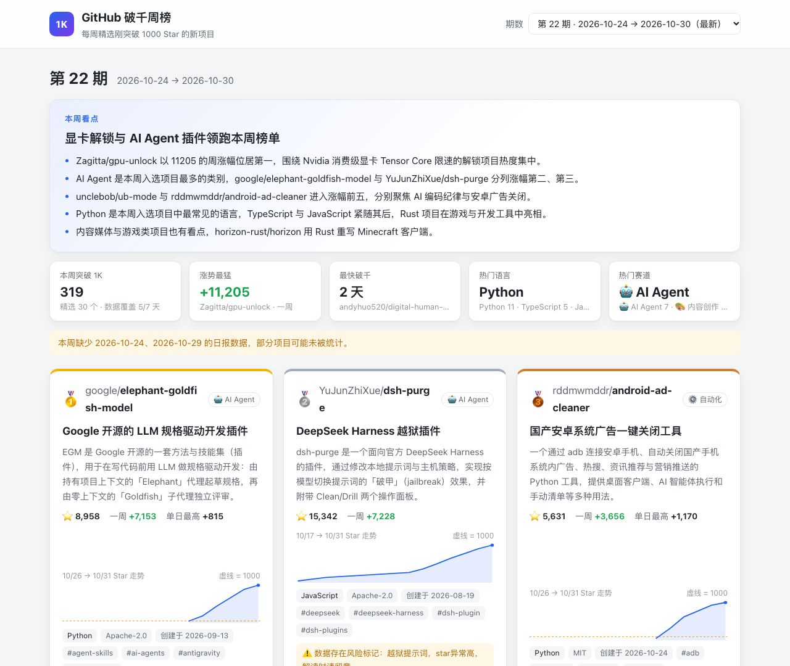

<div align="center">

<b>English</b> · <a href="README.md">简体中文</a>

# github1K · GitHub 1K-Stars Weekly

**Track GitHub repos that just crossed 1,000 stars, every day — with a weekly Top 100 picked and annotated in Chinese by AI.**

[](https://fhan235.github.io/github1K/)

[](https://github.com/fhan235/github1K/actions/workflows/daily.yml)
[](https://github.com/fhan235/github1K/actions/workflows/weekly.yml)
[](https://github.com/fhan235/github1K/actions/workflows/pages.yml)


### 👉 [fhan235.github.io/github1K](https://fhan235.github.io/github1K/)

<a href="https://fhan235.github.io/github1K/">
  
</a>

</div>

---

## Why

GitHub Trending rewards whatever is surging *today*, so the same big-name projects stay on top and genuinely new ones rarely surface.

**1,000 stars is a great threshold**: a project has been validated by enough people, but hasn't gone mainstream yet. Every day, github1K finds repos that were below 1,000 stars yesterday and crossed the line today. Every week, it picks the 100 most worth your attention and writes Chinese summaries — what it is, what problem it solves, who should care.

> 📝 All report content and the website are in **Chinese**. This README is in English so you can fork and adapt the pipeline for your own use.

## ✨ Features

- **Daily 1K breakthrough tracking**: scans only the boundary zones around 1,000 stars and diffs against yesterday's snapshot — finds every breakthrough in 3–6 minutes, including overnight explosions
- **Weekly Top 100**: scores candidates on real weekly star growth, persistence, freshness, and project quality; detects star farming and phantom gains; one entry per author; past honorees never repeat
- **AI-written Chinese summaries**: the LLM reads each README and writes a one-liner, the problem solved, the target audience, alternatives, and risk notes. READMEs are treated as untrusted content to resist prompt injection
- **Weekly highlights**: an editor-style trend summary per issue — all numbers and rankings are computed in code first, the LLM only writes the prose
- **Showcase site**: weekly highlights, large top-3 cards, star-history sparklines, category/language filters, search, past issues, avatars, dark mode, mobile-friendly
- **Daily reports**: browse any day's full breakthrough list on the site — Chinese one-liners, 14-day star trends, and a "today's highlights" digest (backfilled once for all historical days)
- **Zero cost, fully automated**: GitHub Actions on a schedule + GitHub Pages hosting, no server needed

## 🌐 Website

| | |
|---|---|
| **URL** | <https://fhan235.github.io/github1K/> |
| **Updates** | New issue published every Saturday morning (BJT) |
| **Past issues** | Switch via the issue dropdown, or search across all issues |
| **Share an issue** | Append `#w=weekly-START_to_END`, e.g. [`#w=weekly-2026-10-24_to_2026-10-30`](https://fhan235.github.io/github1K/#w=weekly-2026-10-24_to_2026-10-30) |
| **Daily reports** | The "日报" (daily) tab; share a day with `#v=daily&d=2026-10-31` |
| **Static share pages** | Every issue/day also has a JS-free static page (SEO & link-preview friendly): `/w/<issue>/`, `/d/<date>/` |
| **RSS** | <https://fhan235.github.io/github1K/feed.xml> |

From rank #4 down, the weekly list is grouped into collapsible category sections. Daily and weekly views cross-link: daily entries that made the weekly list get a badge, and weekly entries link back to their breakthrough day.

The sparkline on each card comes from daily snapshots; the gold dashed line marks 1,000 stars, so you can tell a slow climb from an overnight spike at a glance.

## 🔧 How it works

```mermaid
flowchart LR
    A[GitHub Search API] -->|daily 06:00 BJT| B[Boundary scan<br/>500–50000 stars]
    B --> C[Diff vs yesterday's snapshot]
    C --> D[(Daily data<br/>data/daily)]
    D -->|Saturday 09:00 BJT| E[Aggregate · verify · score]
    E --> F[LLM triage & category labels]
    F --> G[Top 100]
    G --> H[LLM summaries + highlights]
    H --> I[(Weekly data<br/>data/weekly)]
    I --> J[Build static site]
    J --> K[GitHub Pages]
```



<details>
<summary><b>Daily: boundary-zone scanning</b></summary>

No full scans (those take 30–60 min). Only three ranges are scanned:

```
[Breakthrough zone] stars:1000..50000   ← today's 1K crossings & overnight hits
     ↕ diff vs yesterday's snapshot → "below 1000 yesterday, ≥1000 today"
[Candidate zone]    stars:500..999      ← near the line, snapshotted for tomorrow
[Explosion zone]    stars:>50000        ← phenomenal spikes
```

- Adaptive bisection over language × creation-date to work around the Search API's 1,000-result-per-query cap
- No daily-gain ceiling: a repo going 500 → 50,000 overnight is still caught
- Exponential backoff on all requests; multiple tokens can rotate for speed
- First run has no baseline: `--cold-start` does one full scan to build it

</details>

<details>
<summary><b>Weekly: picking 100 out of a few hundred</b></summary>

1. Read the week's daily data (local JSON → COS JSON → historical Markdown fallback)
2. Deduplicate across days; filter out collections/awesome-lists and legacy giants
3. Re-check each candidate via the GitHub REST API to compute the **real weekly gain**
4. Multi-factor scoring (out of 100)

   | Dimension | Weight | Notes |
   |---|---|---|
   | Growth | 35 | Real weekly gain, log-scaled |
   | Persistence | 25 | Multi-day on the board, still growing a week later |
   | Freshness | 20 | Full score if created ≤ 90 days ago, half within a year |
   | Quality | 20 | License, topics, description, recent commits, fork ratio |
   | Penalties | — | Suspected farming, phantom gains, no description, archived/fork |

5. LLM triage: category labels, junk & marketing detection
6. Diversity: one entry per author; past honorees go to a "still growing" side list if they gained ≥ 500 this week
7. LLM writes each summary (disk-cached, reruns are free) plus the weekly highlights
8. Outputs Markdown + JSON + standalone HTML, committed back to the repo, which triggers the site deploy

Every penalty reason lands in `flags` inside the JSON output, so "why these 100" is always auditable.

</details>

## 🚀 Quick start

> Just want the lists? Open the [website](https://fhan235.github.io/github1K/). Below is for self-hosting or local runs.

```bash
git clone https://github.com/fhan235/github1K.git
cd github1K
pip install -e .
cp .env.example .env        # set G1K_GITHUB_TOKEN; weekly LLM needs G1K_LLM_API_KEY
```

**Daily board**

```bash
python -m src.main --cold-start   # first run: full scan to build the baseline (slow)
python -m src.main                # after that: fast mode, 3–6 minutes
python -m src.main --notify -n 20 # push to WeCom, show Top 20
```

**Weekly board**

```bash
python -m src.weekly.main                                   # last 7 days
python -m src.weekly.main --dry-run                         # no LLM, verify scoring for free
python -m src.weekly.main --start 2026-10-24 --end 2026-10-30
python scripts/backfill_weekly.py --from 2026-05-30 --to 2026-10-23   # backfill past issues in order
```

**Website**

```bash
python scripts/build_site.py                # builds into _site/
python -m http.server -d _site 8000         # preview at http://localhost:8000
```

## ⚙️ Deploy your own

1. Fork this repo
2. **Settings → Secrets and variables → Actions → Secrets**:

   | Secret | Required | Notes |
   |---|---|---|
   | `G1K_GITHUB_TOKENS` | ✅ | GitHub PATs, comma-separated (or a single `G1K_GITHUB_TOKEN`) |
   | `G1K_LLM_API_KEY` | ✅ | OpenAI-compatible API key (DeepSeek by default) |
   | `G1K_WECOM_WEBHOOK_URL` | | WeCom bot webhook for pushes & failure alerts |
   | `TENCENT_SECRET_ID` / `TENCENT_SECRET_KEY` / `TENCENT_COS_BUCKET` / `TENCENT_COS_REGION` | | Tencent COS for full daily reports |

3. **Settings → Pages → Source** → **GitHub Actions**
4. Manually run `🚀 Daily 1K Milestone Tracker` once with "cold start" checked

Optional Variables: `G1K_SITE_BASE_URL` (set if you use a custom domain), `G1K_GOATCOUNTER` (set to your GoatCounter site code to enable privacy-friendly analytics).

Everything updates itself afterwards:

| Workflow | Schedule | Job |
|---|---|---|
| `daily.yml` | 06:00 BJT daily | scan breakthroughs, commit daily data & snapshots |
| `weekly.yml` | 09:00 BJT Saturdays | build the weekly issue, commit reports |
| `pages.yml` | after weekly runs / on site changes | build & deploy the website |

> GitHub Actions schedules can be delayed 5–30 minutes.

<details>
<summary><b>All environment variables</b></summary>

All variables use the `G1K_` prefix and can live in `.env` or the environment; see [`.env.example`](.env.example). Empty values fall back to defaults.

| Variable | Notes | Default |
|---|---|---|
| `G1K_GITHUB_TOKEN` | GitHub PAT (single) | — |
| `G1K_GITHUB_TOKENS` | Multiple PATs, comma-separated, rotated for speed | — |
| `G1K_WECOM_WEBHOOK_URL` | WeCom webhook | — |
| `G1K_REPORT_TOP_N` | Entries in the full report (0 = all) | `0` |
| `G1K_SUMMARY_TOP_N` | Entries in summary & WeCom push | `20` |
| `G1K_REPORT_PUBLIC_BASE_URL` | Public URL prefix for full reports (e.g. COS domain) | — |
| `G1K_CREATED_SINCE` | Only scan repos created after this date | `2020-01-01` |
| `G1K_REQUEST_INTERVAL` | Seconds between requests per token | `2.0` |
| `G1K_ABOVE_UPPER` | Breakthrough-zone star ceiling | `50000` |
| `G1K_CANDIDATE_LOWER` | Candidate-zone star floor | `500` |
| `G1K_HTTP_MAX_RETRIES` | HTTP retry cap | `3` |
| `G1K_SNAPSHOT_KEEP_DAYS` | Snapshot retention | `30` |
| `G1K_LLM_API_KEY` | LLM API key | — |
| `G1K_LLM_BASE_URL` | OpenAI-compatible base URL | `https://api.deepseek.com` |
| `G1K_LLM_MODEL_TRIAGE` | Triage model | `deepseek-chat` |
| `G1K_LLM_MODEL_WRITER` | Summary/highlights model | `deepseek-chat` |
| `G1K_LLM_REASONING_EFFORT` | Passed through as-is; `no_think` disables reasoning on Hunyuan Hy models | — |
| `G1K_WEEKLY_TOP_N` | Weekly picks | `100` |
| `G1K_COS_SECRET_ID` / `G1K_COS_SECRET_KEY` / `G1K_COS_BUCKET` / `G1K_COS_REGION` | Weekly HTML upload to COS (CI reuses `TENCENT_*`) | — |

</details>

<details>
<summary><b>Tencent COS setup (optional)</b></summary>

Full daily reports are large (tens of MB each) and are not committed; store them on COS instead:

1. Create a COS bucket, note the region (e.g. `ap-guangzhou`)
2. To make WeCom links directly openable, set the bucket to public-read/private-write, or bind a custom domain
3. In CAM, create a sub-user key scoped to this bucket only — never use root-account keys
4. Add `TENCENT_SECRET_ID`, `TENCENT_SECRET_KEY`, `TENCENT_COS_BUCKET`, `TENCENT_COS_REGION` to repo Secrets
5. Add `G1K_REPORT_PUBLIC_BASE_URL` to Variables, e.g. `https://your-bucket.cos.ap-guangzhou.myqcloud.com`

</details>

## 📦 Data outputs

| Path | Content | Committed |
|---|---|---|
| `data/daily/milestones_*.json.gz` | Structured daily board: all breakthroughs of the day | ✅ |
| `data/daily/digest_*.json` | AI digest per day (categories, one-liners, full summaries) | ✅ |
| `data/snapshot_*.json.gz` | Daily star snapshots, for diffing & sparklines | ✅ |
| `reports/summary-1k-*.md` | Daily summary | ✅ |
| `reports/milestone-1k-*.md` | Full daily report | COS / Artifact only |
| `data/weekly/weekly-*.json` | Structured weekly data with score breakdowns & AI summaries | ✅ |
| `reports/weekly/weekly-*.md` | Weekly Markdown report | ✅ |
| `data/weekly/seen.json` | All-time honorees, for cross-week dedup | ✅ |

With `--created-since`, filenames get a `_created-since-YYYY-MM-DD` suffix so different scan ranges never mix.

## 🗂️ Project structure

```
github1K/
├── src/
│   ├── main.py            # daily entry point
│   ├── crawlers/          # GitHub Search API scanning
│   ├── storage/           # snapshot & daily persistence
│   ├── reporters/         # daily report rendering
│   ├── notifiers/         # WeCom push
│   └── weekly/            # weekly: aggregate, verify, score, LLM, render, publish
├── web/                   # site frontend (vanilla HTML/CSS/JS, no build step)
├── scripts/
│   ├── build_site.py      # report JSON → static site (share pages, RSS, sitemap)
│   ├── backfill_weekly.py # backfill past weekly issues in order
│   └── regen_highlights.py# regenerate highlights for given issues only
├── data/                  # snapshots, daily & weekly data
├── reports/               # Markdown reports
├── tests/
└── .github/workflows/     # daily / weekly / pages
```

## 🧪 Development

```bash
pip install -e '.[dev]'
pytest
ruff check src scripts tests
```

## 🔒 Security

- Secrets are read from environment variables only; `.env` is git-ignored — **never commit it**
- Third-party READMEs are wrapped as untrusted content in prompts; the model is instructed to summarize, never to execute
- The site renders all text via `textContent`, links are restricted to `github.com`, and a CSP is set
- If a token ever lands in git history, revoke it immediately at <https://github.com/settings/tokens>

## 🙏 Acknowledgements

- Data from the [GitHub REST / Search API](https://docs.github.com/rest)
- Summaries generated by LLMs (DeepSeek and Hunyuan); may contain inaccuracies — trust the project homepage

---

<div align="center">

If this helps you discover something good, a ⭐ is appreciated.

</div>
