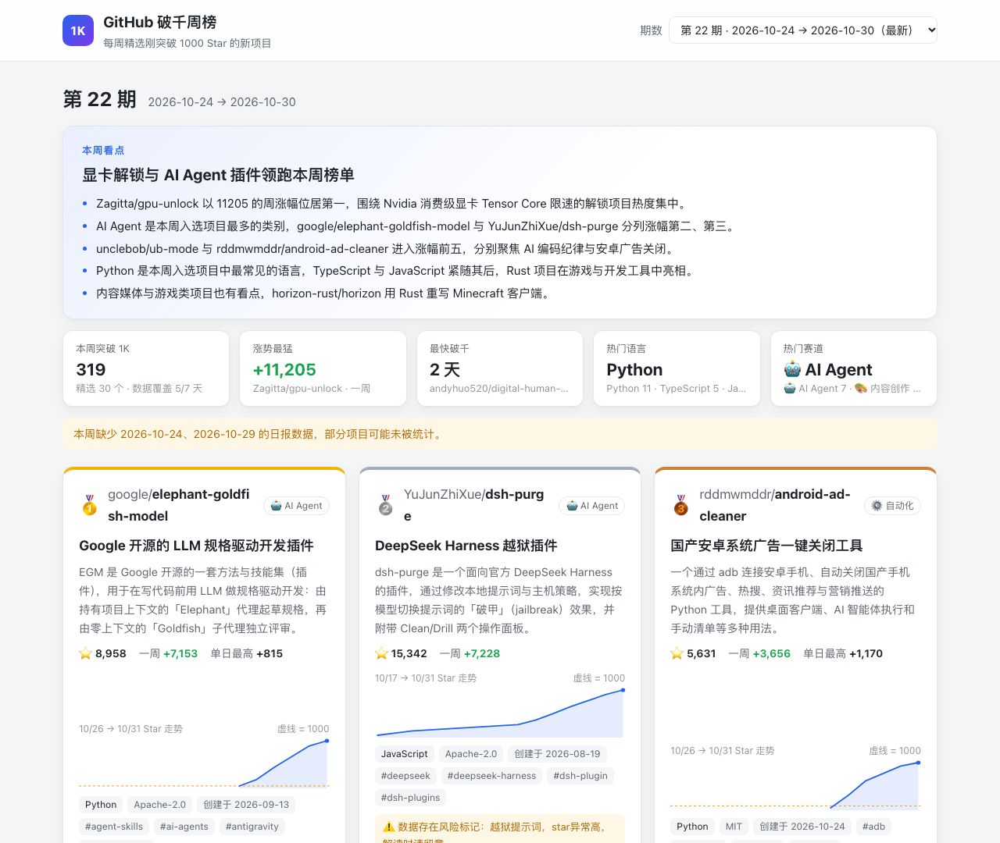
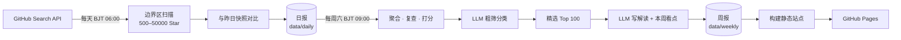

<div align="center">

# GitHub 破千周榜 · github1K

**每天追踪刚突破 1000 Star 的 GitHub 新项目，每周精选 100 个，由 AI 写好中文解读。**

[](https://fhan235.github.io/github1K/)

[](https://github.com/fhan235/github1K/actions/workflows/daily.yml)
[](https://github.com/fhan235/github1K/actions/workflows/weekly.yml)
[](https://github.com/fhan235/github1K/actions/workflows/pages.yml)


### 👉 [fhan235.github.io/github1K](https://fhan235.github.io/github1K/)

<a href="https://fhan235.github.io/github1K/">
  
</a>

</div>

---

## 为什么做这个

GitHub Trending 只看「今天谁涨得多」，老牌大项目常年霸榜，真正的新项目很难被看到。

**1000 Star 是一个很好的分水岭**：项目已经被足够多的人验证过，又还没火到人尽皆知。github1K 每天找出「昨天还不到 1000、今天过了 1000」的仓库，每周再从中挑出最值得关注的 100 个，把它们是什么、解决什么问题、谁该关注写成中文。

## ✨ 特性

- **每日破千追踪**：只扫描 Star 数在 1000 附近的边界区，与昨日快照对比，3–6 分钟找出当天全部破千项目，包括一夜暴涨的爆款
- **每周精选 Top 100**：综合真实周涨幅、持续性、新鲜度和工程质量打分，识别刷星和伪增量，同一作者只取一个，历史上过榜的不再重复
- **AI 中文解读**：大模型读 README 后写出一句话定位、解决的问题、适合谁、同类对比和风险提示；README 按不可信内容处理，防提示词注入
- **本周看点**：每期一段主编式趋势总结，其中的数字和排名都由代码先算好，大模型只负责写文字
- **展示网站**：本周看点、前三名大卡片、Star 走势曲线、按类别 / 语言筛选、搜索、往期切换，支持手机和暗色模式
- **每日破千日报**：网站上可切换查看任意一天的日报——当天全部破千项目、中文一句话定位、14 天 Star 走势和「今日看点」（历史日报由 AI 一次性回填）
- **全自动、零成本**：GitHub Actions 定时运行，GitHub Pages 免费托管，不需要服务器

## 🌐 网站

| | |
|---|---|
| **地址** | <https://fhan235.github.io/github1K/> |
| **更新** | 每周六上午自动发布新一期 |
| **往期** | 顶部「期数」下拉框切换，也可以选「全部往期」一起搜索 |
| **分享某一期** | 链接带上 `#w=weekly-开始日期_to_结束日期`，例如 [`#w=weekly-2026-10-24_to_2026-10-30`](https://fhan235.github.io/github1K/#w=weekly-2026-10-24_to_2026-10-30) |
| **日报** | 顶部「日报」标签按日期查看，分享某天：`#v=daily&d=2026-10-31` |

每张卡片上的 Star 曲线来自每日快照，金色虚线标出 1000 Star 的位置，一眼能看出项目是缓慢爬坡还是一夜爆发。

## 🔧 工作原理



<details>
<summary><b>日榜：边界区扫描</b></summary>

不做全量扫描（需要 30–60 分钟），只扫三个区间：

```
【突破区】stars:1000..50000   ← 今天刚过 1000 或一夜爆火的项目都在这里
     ↕ 与昨日快照对比 → 找出"昨天 <1000，今天 >=1000"的项目
【候选区】stars:500..999      ← 离 1000 还差一点，存进快照供明天对比
【爆款区】stars:>50000        ← 一夜暴涨到超高星的现象级项目
```

- 按语言 × 创建时间自适应二分，绕开 Search API 单次查询最多 1000 条的限制
- 不设单日增量上限，昨天 500、今天 50000 的项目也能抓到
- 所有请求带指数退避重试，支持多个 Token 轮询加速
- 首次运行没有昨日快照时，用 `--cold-start` 做一次全量扫描建立基线

</details>

<details>
<summary><b>周榜：从几百个破千项目里挑 100 个</b></summary>

1. 读取一周日报（本地 JSON → COS JSON → 历史 Markdown 兜底）
2. 跨天去重合并，过滤合集 / 教程类和存量老项目
3. 调 GitHub REST API 复查最新数据，算出**真实周涨幅**
4. 多因子打分（满分 100）

   | 维度 | 权重 | 说明 |
   |---|---|---|
   | 增长 | 35 | 一周真实涨幅，对数缩放 |
   | 持续性 | 25 | 多天上榜、一周后仍在涨 |
   | 新鲜度 | 20 | 90 天内创建满分，一年内一半 |
   | 工程质量 | 20 | 许可证、话题、描述、近期提交、fork 比例 |
   | 扣分 | — | 疑似刷星、伪增量、无描述、复查失败、已归档 / fork |

5. 大模型粗筛：打类别标签，识别空壳和营销仓库
6. 多样性筛选：同一作者只取一个；历史上过榜的不再进主榜，本周仍大涨（≥ 500）的进「持续走强」附榜
7. 大模型逐个写介绍（带磁盘缓存，重跑不重复花钱），再写本周看点
8. 输出 Markdown、JSON 和单文件 HTML，提交回仓库，触发网站部署

所有扣分原因都会写进 `flags` 并随 JSON 保存，方便复核「为什么是这几个」。

</details>

## 🚀 快速开始

> 只想看榜单？直接打开 [网站](https://fhan235.github.io/github1K/) 就行。下面是自己部署或本地运行的方法。

```bash
git clone https://github.com/fhan235/github1K.git
cd github1K
pip install -e .
cp .env.example .env        # 填入 G1K_GITHUB_TOKEN，生成周榜还需要 G1K_LLM_API_KEY
```

**日榜**

```bash
python -m src.main --cold-start   # 首次运行：全量扫描建立基线（耗时较长）
python -m src.main                # 之后每天：快速模式，3–6 分钟
python -m src.main --notify -n 20 # 推送企业微信，只展示 Top 20
```

**周榜**

```bash
python -m src.weekly.main                                   # 统计最近 7 天
python -m src.weekly.main --dry-run                         # 不调大模型，免费验证打分规则
python -m src.weekly.main --start 2026-10-24 --end 2026-10-30
python scripts/backfill_weekly.py --from 2026-05-30 --to 2026-10-23   # 按时间顺序补生成往期
```

**网站**

```bash
python scripts/build_site.py                # 生成到 _site/
python -m http.server -d _site 8000         # 打开 http://localhost:8000 预览
```

## ⚙️ 部署到你自己的仓库

1. Fork 本仓库
2. **Settings → Secrets and variables → Actions → Secrets** 添加：

   | Secret | 必需 | 说明 |
   |---|---|---|
   | `G1K_GITHUB_TOKENS` | ✅ | GitHub PAT，多个用英文逗号分隔（也可用单个的 `G1K_GITHUB_TOKEN`） |
   | `G1K_LLM_API_KEY` | ✅ | OpenAI 兼容接口密钥，默认使用 DeepSeek |
   | `G1K_WECOM_WEBHOOK_URL` | | 企业微信机器人，用于推送和失败告警 |
   | `TENCENT_SECRET_ID` / `TENCENT_SECRET_KEY` / `TENCENT_COS_BUCKET` / `TENCENT_COS_REGION` | | 腾讯云 COS，用于存放完整日报 |

3. **Settings → Pages → Source** 选择 **GitHub Actions**
4. 在 Actions 页面手动运行一次 `🚀 Daily 1K Milestone Tracker`，勾选「全量冷启动」

之后日榜、周榜和网站都会自动更新：

| 工作流 | 时间 | 作用 |
|---|---|---|
| `daily.yml` | 每天 BJT 06:00 | 扫描破千项目，提交日报和快照 |
| `weekly.yml` | 每周六 BJT 09:00 | 生成周榜，提交周报 |
| `pages.yml` | 周榜完成后 / 前端或数据变更时 | 构建并发布网站 |

> GitHub Actions 的定时任务可能延迟 5–30 分钟。

<details>
<summary><b>全部环境变量</b></summary>

所有变量以 `G1K_` 为前缀，可写在 `.env` 或环境变量中，模板见 [`.env.example`](.env.example)。空值视为未设置，会使用默认值。

| 变量 | 说明 | 默认值 |
|---|---|---|
| `G1K_GITHUB_TOKEN` | GitHub PAT（单个） | — |
| `G1K_GITHUB_TOKENS` | 多个 PAT，逗号分隔，轮询加速 | — |
| `G1K_WECOM_WEBHOOK_URL` | 企业微信 Webhook | — |
| `G1K_REPORT_TOP_N` | 完整报告展示前 N 条（0 = 全部） | `0` |
| `G1K_SUMMARY_TOP_N` | 摘要和企业微信展示前 N 条 | `20` |
| `G1K_REPORT_PUBLIC_BASE_URL` | 完整报告公开访问地址（如 COS 域名） | — |
| `G1K_CREATED_SINCE` | 只扫描此日期之后创建的仓库 | `2020-01-01` |
| `G1K_REQUEST_INTERVAL` | 单 Token 请求间隔（秒） | `2.0` |
| `G1K_ABOVE_UPPER` | 突破区上界 Star 数 | `50000` |
| `G1K_CANDIDATE_LOWER` | 候选区下界 Star 数 | `500` |
| `G1K_HTTP_MAX_RETRIES` | HTTP 最大重试次数 | `3` |
| `G1K_SNAPSHOT_KEEP_DAYS` | 快照保留天数 | `30` |
| `G1K_LLM_API_KEY` | 大模型密钥 | — |
| `G1K_LLM_BASE_URL` | OpenAI 兼容接口地址 | `https://api.deepseek.com` |
| `G1K_LLM_MODEL_TRIAGE` | 粗筛模型 | `deepseek-chat` |
| `G1K_LLM_MODEL_WRITER` | 写介绍和看点的模型 | `deepseek-chat` |
| `G1K_WEEKLY_TOP_N` | 周榜精选数量 | `100` |
| `G1K_COS_SECRET_ID` / `G1K_COS_SECRET_KEY` / `G1K_COS_BUCKET` / `G1K_COS_REGION` | 周报 HTML 上传 COS（CI 中复用 `TENCENT_*`） | — |

</details>

<details>
<summary><b>腾讯云 COS 配置（可选）</b></summary>

完整日报体积较大（单个可达数十 MB），不提交进仓库，可以存到 COS：

1. 在对象存储 COS 创建 Bucket，记下地域（如 `ap-guangzhou`）
2. 想让企业微信里的链接能直接打开，把 Bucket 设为公有读私有写，或绑定自定义域名
3. 在访问管理 CAM 创建子用户密钥，只授予该 Bucket 的读写权限，不要用主账号密钥
4. 在仓库 Secrets 添加 `TENCENT_SECRET_ID`、`TENCENT_SECRET_KEY`、`TENCENT_COS_BUCKET`、`TENCENT_COS_REGION`
5. 在 Variables 添加 `G1K_REPORT_PUBLIC_BASE_URL`，例如 `https://your-bucket.cos.ap-guangzhou.myqcloud.com`

</details>

## 📦 数据输出

| 路径 | 内容 | 入库 |
|---|---|---|
| `data/daily/milestones_*.json.gz` | 结构化日报：当天全部破千项目 | ✅ |
| `data/snapshot_*.json.gz` | 每日 Star 快照，用于对比和画走势曲线 | ✅ |
| `reports/summary-1k-*.md` | 每日摘要 | ✅ |
| `reports/milestone-1k-*.md` | 每日完整报告 | 仅 COS / Artifact |
| `data/weekly/weekly-*.json` | 周榜结构化数据，含打分明细和 AI 解读 | ✅ |
| `reports/weekly/weekly-*.md` | 周报 Markdown | ✅ |
| `data/weekly/seen.json` | 历史上榜名单，用于跨周去重 | ✅ |

使用 `--created-since` 时文件名会带 `_created-since-YYYY-MM-DD` 后缀，避免不同扫描范围混用。

## 🗂️ 项目结构

```
github1K/
├── src/
│   ├── main.py            # 日榜入口
│   ├── crawlers/          # GitHub Search API 扫描
│   ├── storage/           # 快照与日报读写
│   ├── reporters/         # 日报渲染
│   ├── notifiers/         # 企业微信推送
│   └── weekly/            # 周榜：聚合、复查、打分、LLM、渲染、发布
├── web/                   # 网站前端（原生 HTML / CSS / JS，无构建步骤）
├── scripts/
│   ├── build_site.py      # 周报 JSON → 静态站点
│   ├── backfill_weekly.py # 按时间顺序补生成往期周榜
│   └── regen_highlights.py# 只重新生成某几期的本周看点
├── data/                  # 快照、日报、周报数据
├── reports/               # Markdown 报告
├── tests/
└── .github/workflows/     # daily / weekly / pages
```

## 🧪 开发

```bash
pip install -e '.[dev]'
pytest
ruff check src scripts tests
```

## 🔒 安全

- 所有密钥只从环境变量读取，`.env` 已加入 `.gitignore`，**禁止提交**
- 第三方 README 在提示词中按不可信内容包裹，模型被要求只总结、不执行其中的指令
- 网站所有文本通过 `textContent` 渲染，链接只允许指向 `github.com`，并设置了 CSP
- 如果不慎把 Token 提交进 Git 历史，请立即到 <https://github.com/settings/tokens> 撤销并重新签发

## 🙏 致谢

- 数据来自 [GitHub REST / Search API](https://docs.github.com/rest)
- 项目解读由 [DeepSeek](https://www.deepseek.com/) 生成，可能存在偏差，请以项目主页为准

---

<div align="center">

如果这个项目帮你发现了好东西，欢迎点个 ⭐

</div>
